# Google Summer of Code 2026 · Final Report

  

| | |
|---|---|
| **Contributor** | Saksham Jain · [@reach2saksham](https://github.com/reach2saksham) · Discord `@theonlypro47` · [X](https://x.com/sakshamjainiitr) · [LinkedIn](https://www.linkedin.com/in/sakshamjainiitr/) |
| **Organization** | [AOSSIE](https://aossie.org) (Australian Open Source Software Innovation and Education), with work in [Stability Nexus](https://github.com/StabilityNexus) and [Djed Alliance](https://github.com/DjedAlliance) |
| **Project** | *Engineering i18n, l10n ready, dual theme, WCAG 2.2 aware & optimized frontends, pages & npm packages* · [GSoC project page](https://summerofcode.withgoogle.com/programs/2026/projects/19Upjrdb) |
| **Mentors** | Bruno ([@Zahnentferner](https://github.com/Zahnentferner)) · Madhav ([@M4dhav](https://github.com/M4dhav)) |
| **Portfolio** | [sakshamjain.in](https://www.sakshamjain.in/) |
| **Project size** | Large · 22 weeks |
| **Latest version of this report** | [Portfolio Case Study](https://www.sakshamjain.in/design/gsoc) · [GitHub](https://github.com/reach2saksham/GSoC-2026-AOSSIE/blob/main/README.md)

## TL;DR

> **I took the web presence of AOSSIE and its projects from scattered and inconsistent to one scalable, maintainable, design-engineered system.**
>
> **Perspective AI was the centrepiece, rebuilt from 0 to 1 for real users.** I modernised both its frontend and its backend around adoption: a clear first-run flow from pasting an article to seeing balanced perspectives, a bias meter, fact checks and chat, a multilingual interface, and a hardened, well-configured backend that is safe to put in front of the public.
>
> **I turned AOSSIE's two UI libraries, Social Share Button and Support Us Button, into npm packages** with a clear API that drops into any site, and designed their product flow so each component is obvious to adopt and pleasant to use.
>
> **I built the AOSSIE brand identity** (logos for the org and its projects, colour system, type scales and templates) **and carried it from Figma to production** across the AOSSIE website and its project sites, with semantic design tokens, a shared design system, reusable components and purposeful motion on one holistic, scalable Next.js architecture that future contributors can start from.
>
> **Every repository meets a high engineering bar:** SEO and social previews, WCAG 2.2-aware accessibility (a11y), internationalisation (i18n) and localisation (l10n), CI/CD with tests covering the whole code base, clear documentation, agent skill files, readiness for agentic browsing, peer audits and security reviews. The result is a web presence that represents AOSSIE well and a benchmark for the contributors who come next.

| 🚀 Live sites | 🔀 Merged PRs | 📦 Repositories | 🎨 Design | ✅ Quality |
|:---:|:---:|:---:|:---:|:---:|
| **7** Live (6 on `*.aossie.org`) · Perspective awaiting backend hosting | **67** merged: 46 in the coding period + 7 final-checklist PRs + 2 peer reviews + 12 in community bonding | **12** in 3 orgs (AOSSIE-Org, Stability Nexus, Djed Alliance) + a starter template | **4** Figma files · brand kit · **10+** recreated SVG logos | **2,150+** tests, every repo above 98% coverage · 8 security reviews · 4 findings fixed · **25+** issues closed |

**🎬 Watch:** [Proposal Demo](https://www.loom.com/share/fd9c8d4ca61f47fab239f75285305942) · [Mid-term Demo](https://www.loom.com/share/a40671aaace44d4c95d4e4d3f004c373) · [End-term Demos](https://www.loom.com/share/folder/802e8f14406a49c0a124380ac29e69ab) · Weekly Demo Videos in [2](#2-goals-and-the-journey-week-by-week)

**🌐 Try it:**

- AOSSIE Main Website: [aossie.org](https://aossie.org)
- Resonate: [resonate.aossie.org](https://resonate.aossie.org)
- Zplit: [zplit.aossie.org](https://zplit.aossie.org)
- MoveYourBody: [move.aossie.org](https://move.aossie.org)
- PictoPy: [pictopy.aossie.org](https://pictopy.aossie.org)
- Social Share Button: [social-share-button.aossie.org](https://social-share-button.aossie.org)
- Support Us Button: [aossie-org.github.io/SupportUsButton](https://aossie-org.github.io/SupportUsButton/)
- AOSSIE intro video: [watch (1080p)](https://github.com/AOSSIE-Org/Info/blob/main/Brand/Media%20Assets/AOSSIE%20Intro%20Video/intro_1080p.mp4)
- AOSSIE Branding Kit: [Figma](https://www.figma.com/design/ywJ3jFa67bdQsN5XczrHy3/AOSSIE-s-Brand-Kit?node-id=0-1) · [assets in the Info repo](https://github.com/AOSSIE-Org/Info/tree/main/Brand)

## Table of contents

1. [The problem I set out to solve](#1-the-problem-i-set-out-to-solve)
2. [Goals and the journey, week by week](#2-goals-and-the-journey-week-by-week)
3. [Project by project](#3-project-by-project)
4. [Numbers](#4-numbers)
5. [Quality: the GSoC completion checklist](#5-quality-the-gsoc-completion-checklist)
6. [Current state and what's left](#6-current-state-and-whats-left)
7. [Summary of achievements](#7-summary-of-achievements)
8. [Challenges and how I solved them](#8-challenges-and-how-i-solved-them)
9. [What I learned](#9-what-i-learned)
10. [All pull requests](#10-all-pull-requests)
11. [Acknowledgements](#11-acknowledgements)

## 1. The problem I set out to solve

AOSSIE builds technically strong software, but at the start of 2026 its web presence didn't show it. As I put it in my [proposal](https://www.loom.com/share/fd9c8d4ca61f47fab239f75285305942), a project without a clear, welcoming landing gateway loses its first chance to connect with users, however good the software underneath is.

**What I found:**

- **No clear entry point for end users.** Project pages mostly spoke to contributors rather than the people who would use the app. MoveYourBody had no website at all; others ran on older stacks (Vite, a GSoC 2025 design), and the AOSSIE website predated the App Router.
- **No brand identity.** Logos existed mostly as PNGs, colours and type varied from site to site, and contributors had no single place to find official assets.
- **Missing basics.** Many sites had no i18n, no dark mode, no sitemap or Open Graph metadata, no tests and no CI. Shared links often showed no preview at all.
- **Every new site started from scratch.** The Next.js template lacked the i18n, theming and static-export setup that a real landing page needs.
- **Shared components that weren't ready to share.** Social Share Button had no test suite, and Support Us Button's styles could leak into the page that imported it, so neither could simply be dropped into every AOSSIE site.
- **Perspective AI had no path to real users.** Its frontend couldn't be deployed as a static site, and its backend wasn't yet hardened to face the public.

**The deeper problem.** Pages built without UX thinking or a plan for maintenance go generic, stale or unused. So the goal was not just more pages but a system: sites that drive adoption, need little upkeep, and serve both end users and contributors.

**My proposal:** design and build a consistent, accessible, internationalised workflow for each project's gateway, on a shared foundation (brand kit + template), with the same responsibilities for every site:

> Figma design (desktop, mobile, dark and light) → architecture (next-intl, next-themes, SEO basics, agentic readiness, design tokens) → all sections → WCAG 2.2 (keyboard navigation, focus states, contrast) → responsive layouts → performance and Open Graph → Lighthouse benchmarking → bug fixes and deployment.

## 2. Goals and the journey, week by week

This table follows my weekly plan, including the changes my mentors and I agreed on during the summer. Each week had a public post and, where there was something to show, a demo video. All Figma files are listed in [Design work](#32-design-work-brand-kit-figma-and-logos).

| Weeks | Goal / Project | Status | PRs | Live | Figma | Post | Demo |
|:---:|---|:---:|---|:---:|---|---|---|
| 1-2 | **Resonate:** complete development, mockups, features showcase, deployment with maintainers and peers | ✅ | [#368](https://github.com/AOSSIE-Org/Resonate-Website/pull/368) [#369](https://github.com/AOSSIE-Org/Resonate-Website/pull/369) [#370](https://github.com/AOSSIE-Org/Resonate-Website/pull/370) [#373](https://github.com/AOSSIE-Org/Resonate-Website/pull/373) [#384](https://github.com/AOSSIE-Org/Resonate-Website/pull/384) [#387](https://github.com/AOSSIE-Org/Resonate-Website/pull/387) [#389](https://github.com/AOSSIE-Org/Resonate-Website/pull/389) [#391](https://github.com/AOSSIE-Org/Resonate-Website/pull/391) | [Live](https://resonate.aossie.org) | [Figma](https://www.figma.com/design/7tHcjQQSoGGL2jZfs5OzQK/GSoC-AOSSIE-Designs-Public?node-id=4-5856) | [W1](https://x.com/sakshamjainiitr/status/2061497598884917668) [W2](https://x.com/sakshamjainiitr/status/2065027476158558656) | [▶️ W1](https://github.com/user-attachments/assets/9e8c2930-aed2-43f9-bb60-0e0ea5635999) [▶️ W2](https://github.com/user-attachments/assets/be326364-5f68-40a5-b5a4-4142f643b54e) |
| 3-4 | **AOSSIE brand kit:** AOSSIE Figma community account, Figma files organised, logos vectorised, guidelines, colour system, typography, mockups, meeting backgrounds, post templates, banners, moodboards, swag, design system | ✅ | [Info #72](https://github.com/AOSSIE-Org/Info/pull/72) [Info #73](https://github.com/AOSSIE-Org/Info/pull/73) | - | [Brand Kit](https://www.figma.com/design/ywJ3jFa67bdQsN5XczrHy3/AOSSIE-s-Brand-Kit?node-id=0-1) [Logos Hub](https://www.figma.com/design/cQCpSQv0M6FAc62ncunx8s/Logos-Hub?node-id=2048-293) [Drafts and Backups](https://www.figma.com/design/t0XXc7r3lTO3Y2m8HnU1Vv/Drafts-and-BackUps?node-id=0-1) [first iteration](https://www.figma.com/design/7tHcjQQSoGGL2jZfs5OzQK/GSoC-AOSSIE-Designs-Public?node-id=2097-2) | [W3-4](https://x.com/sakshamjainiitr/status/2070812955550392597) | - |
| 5-6 | **Support Us Button:** workflow, Figma design, development and deployment | ✅ | [#32](https://github.com/AOSSIE-Org/SupportUsButton/pull/32) [#36](https://github.com/AOSSIE-Org/SupportUsButton/pull/36) [#37](https://github.com/AOSSIE-Org/SupportUsButton/pull/37) [#44](https://github.com/AOSSIE-Org/SupportUsButton/pull/44) | [Live](https://aossie-org.github.io/SupportUsButton/) | [Figma](https://www.figma.com/design/7tHcjQQSoGGL2jZfs5OzQK/GSoC-AOSSIE-Designs-Public?node-id=76-915) | [W5-6](https://x.com/sakshamjainiitr/status/2075923876664795567) | [▶️ W5](https://github.com/user-attachments/assets/53d8dbad-5b28-4f31-a13d-0bbe6b4e9052) [▶️ W6](https://github.com/user-attachments/assets/58e04005-a78e-4721-b3e6-4e4a2b091c01) |
| 7-8 | **AOSSIE Website:** direction and scope ([planning doc](https://docs.google.com/document/d/1LuvGrmI_9tq52_AVxCmQCf0vdxLsYnOpgkQhZRVheME/edit)), Figma approval, development, testing and polish; Fate and OrgExplorer SVG logos | ✅ | [#737](https://github.com/AOSSIE-Org/Website/pull/737) [#739](https://github.com/AOSSIE-Org/Website/pull/739) [#740](https://github.com/AOSSIE-Org/Website/pull/740) [#741](https://github.com/AOSSIE-Org/Website/pull/741) [#744](https://github.com/AOSSIE-Org/Website/pull/744) [#745](https://github.com/AOSSIE-Org/Website/pull/745) · [#732](https://github.com/AOSSIE-Org/Website/pull/732) | [Live](https://aossie.org) | [Figma](https://www.figma.com/design/7tHcjQQSoGGL2jZfs5OzQK/GSoC-AOSSIE-Designs-Public?node-id=5-5857) | [W7-8](https://x.com/sakshamjainiitr/status/2080883906816118881) | [▶️ W7](https://github.com/user-attachments/assets/1f3c44e8-c9f2-4952-9940-548ee18ce2cc) [▶️ W8](https://github.com/user-attachments/assets/1927374e-d2db-45d8-a28f-cd2c94aece9f) |
| 9-10 | **PictoPy:** mockups, development and deployment · **Next.js template:** [webpage-starter](https://github.com/reach2saksham/webpage-starter) upstreamed into Template-Repo-NextJS · Stability Nexus and Skills Ecosystem logos | ✅ | [#28](https://github.com/AOSSIE-Org/PictoPy-Website/pull/28) [#29](https://github.com/AOSSIE-Org/PictoPy-Website/pull/29) [#35](https://github.com/AOSSIE-Org/PictoPy-Website/pull/35) · [#11](https://github.com/AOSSIE-Org/Template-Repo-NextJS/pull/11) [#12](https://github.com/AOSSIE-Org/Template-Repo-NextJS/pull/12) [#13](https://github.com/AOSSIE-Org/Template-Repo-NextJS/pull/13) [#14](https://github.com/AOSSIE-Org/Template-Repo-NextJS/pull/14) | [Live](https://pictopy.aossie.org) | [Figma](https://www.figma.com/design/7tHcjQQSoGGL2jZfs5OzQK/GSoC-AOSSIE-Designs-Public?node-id=0-1) [Stability Nexus logo](https://www.figma.com/design/7tHcjQQSoGGL2jZfs5OzQK/GSoC-AOSSIE-Designs-Public?node-id=2241-322) [Skills Ecosystem logo](https://www.figma.com/design/7tHcjQQSoGGL2jZfs5OzQK/GSoC-AOSSIE-Designs-Public?node-id=2250-427) | [W9](https://x.com/sakshamjainiitr/status/2080999944765506010) [W10](https://x.com/sakshamjainiitr/status/2083544359681839462) [LinkedIn W9-10](https://www.linkedin.com/posts/sakshamjainiitr_gsoc-googlesummerofcode-opensource-ugcPost-7486776379775135745-KLvt/) | [▶️ W9](https://1drv.ms/v/c/2b55451e453f4443/IQB_cSK6h1NqQI5z3Hg9BEMOAW9FKtHajIZPBytcSXo_qtI?e=TCIOhr) [▶️ W10](https://github.com/user-attachments/assets/bde665af-6234-4766-a0ed-e71fa3efe4c2) |
| 11-12 | **Zplit:** Figma design with peer and mentor feedback, development and deployment; Zplit, CarbonTracker and Chainvoice SVG recreations | ✅ | [#22](https://github.com/AOSSIE-Org/Zplit-Website/pull/22) [#24](https://github.com/AOSSIE-Org/Zplit-Website/pull/24) [#42](https://github.com/AOSSIE-Org/Zplit-Website/pull/42) [#45](https://github.com/AOSSIE-Org/Zplit-Website/pull/45) [#47](https://github.com/AOSSIE-Org/Zplit-Website/pull/47) | [Live](https://zplit.aossie.org) | [Figma](https://www.figma.com/design/7tHcjQQSoGGL2jZfs5OzQK/GSoC-AOSSIE-Designs-Public?node-id=2816-30) | [W11](https://x.com/sakshamjainiitr/status/2086083982769414457) [W12-13](https://x.com/sakshamjainiitr/status/2094055178634977389) | [▶️ W11](https://github.com/user-attachments/assets/ad7e3262-159b-4b7b-b418-3c8b850c3167) [▶️ W12](https://github.com/user-attachments/assets/3dacdc91-43a7-439c-9f43-72accf1bfc65) |
| 13-14 | **Perspective AI:** new structure, connection to the backend, all tabbed sections, testing | ✅🟡 Built and merged · deploy waits on backend cloud hosting (discussed with Mentor) | [#158](https://github.com/AOSSIE-Org/Perspective/pull/158) [#169](https://github.com/AOSSIE-Org/Perspective/pull/169) | - | [Figma](https://www.figma.com/design/7tHcjQQSoGGL2jZfs5OzQK/GSoC-AOSSIE-Designs-Public?node-id=3-79224) | [W12-13](https://x.com/sakshamjainiitr/status/2094055178634977389) [W14-15](https://x.com/sakshamjainiitr/status/2103483095676858844) | [▶️ W14](https://github.com/user-attachments/assets/11b45e9e-f326-4f7a-a706-2f853392e47a) |
| 15-16 | **MoveYourBody:** Figma design (the website repo didn't exist yet), development and deployment | ✅ | [#1](https://github.com/AOSSIE-Org/MoveYourBody-Website/pull/1) | [Live](https://move.aossie.org) | [Figma](https://www.figma.com/design/7tHcjQQSoGGL2jZfs5OzQK/GSoC-AOSSIE-Designs-Public?node-id=2889-323) | [W14-15](https://x.com/sakshamjainiitr/status/2103483095676858844) [W16-17](https://x.com/sakshamjainiitr/status/2103928643479347436) | [▶️ W16](https://github.com/user-attachments/assets/40906b67-ffae-414a-a7dc-3018cdb75e55) |
| 17 | **DebateAI frontend gateway design** | ✅ | - | - | [Figma](https://www.figma.com/design/7tHcjQQSoGGL2jZfs5OzQK/GSoC-AOSSIE-Designs-Public?node-id=2909-2) | [W16-17](https://x.com/sakshamjainiitr/status/2103928643479347436) | - |
| 18-19 | **Social Share Button:** Figma design, development and deployment · **AOSSIE intro video** | ✅ | [#251](https://github.com/AOSSIE-Org/SocialShareButton/pull/251) · [Info #78](https://github.com/AOSSIE-Org/Info/pull/78) | [Live](https://social-share-button.aossie.org) | [Figma](https://www.figma.com/design/7tHcjQQSoGGL2jZfs5OzQK/GSoC-AOSSIE-Designs-Public?node-id=1-3459) | [W18](https://x.com/sakshamjainiitr/status/2104144250510450740) [W19-20](https://x.com/sakshamjainiitr/status/2114300529497268342) | [▶️ W19](https://github.com/user-attachments/assets/d46031c7-8c8f-4cda-9d0a-a9c025e52670) |
| 20-21 | **Final documentation and GSoC completion checklist** for every repo ([quality checklist](#5-quality-the-gsoc-completion-checklist)) · peer reviews for Stability Nexus | ✅ | [Resonate #401](https://github.com/AOSSIE-Org/Resonate-Website/pull/401) [Resonate #411](https://github.com/AOSSIE-Org/Resonate-Website/pull/411) [Support Us #47](https://github.com/AOSSIE-Org/SupportUsButton/pull/47) [Support Us #49](https://github.com/AOSSIE-Org/SupportUsButton/pull/49) [Website #749](https://github.com/AOSSIE-Org/Website/pull/749) [Website #759](https://github.com/AOSSIE-Org/Website/pull/759) [PictoPy #36](https://github.com/AOSSIE-Org/PictoPy-Website/pull/36) [PictoPy #37](https://github.com/AOSSIE-Org/PictoPy-Website/pull/37) [PictoPy #40](https://github.com/AOSSIE-Org/PictoPy-Website/pull/40) [Zplit #52](https://github.com/AOSSIE-Org/Zplit-Website/pull/52) [Zplit #60](https://github.com/AOSSIE-Org/Zplit-Website/pull/60) [Perspective #180](https://github.com/AOSSIE-Org/Perspective/pull/180) [Perspective #185](https://github.com/AOSSIE-Org/Perspective/pull/185) [MoveYourBody #2](https://github.com/AOSSIE-Org/MoveYourBody-Website/pull/2) [MoveYourBody #10](https://github.com/AOSSIE-Org/MoveYourBody-Website/pull/10) [Social Share #258](https://github.com/AOSSIE-Org/SocialShareButton/pull/258) [Social Share #261](https://github.com/AOSSIE-Org/SocialShareButton/pull/261) [Social Share #262](https://github.com/AOSSIE-Org/SocialShareButton/pull/262) [Gluon-LandingPage #21](https://github.com/StabilityNexus/Gluon-LandingPage/pull/21) [StabilityNexus/Website #80](https://github.com/StabilityNexus/Website/pull/80) | - | - | [W19-20](https://x.com/sakshamjainiitr/status/2114300529497268342) [W21-22](https://x.com/sakshamjainiitr/status/2117172802604482983) | [▶️ End-term demos](https://www.loom.com/share/folder/802e8f14406a49c0a124380ac29e69ab) |
| 22 | **Announcements, launch posts, marketing and final forms** | ✅ | - | - | - | [W21-22](https://x.com/sakshamjainiitr/status/2117172802604482983) [Product Hunt: Social Share Button](https://www.producthunt.com/products/social-share-button) [Hacker News: Show HN](https://news.ycombinator.com/item?id=50334725) [r/SideProject](https://www.reddit.com/r/SideProject/comments/1xlsv1a/i_rebuilt_the_website_core_functionsfeatures_and/) | [▶️ End-term demos](https://www.loom.com/share/folder/802e8f14406a49c0a124380ac29e69ab) |

## 3. Project by project

### 3.1 Resonate · [resonate.aossie.org](https://resonate.aossie.org)

  

**What I shipped** ([#321](https://github.com/AOSSIE-Org/Resonate-Website/pull/321), [#325](https://github.com/AOSSIE-Org/Resonate-Website/pull/325), [#327](https://github.com/AOSSIE-Org/Resonate-Website/pull/327), [#351](https://github.com/AOSSIE-Org/Resonate-Website/pull/351), [#368](https://github.com/AOSSIE-Org/Resonate-Website/pull/368), [#369](https://github.com/AOSSIE-Org/Resonate-Website/pull/369), [#370](https://github.com/AOSSIE-Org/Resonate-Website/pull/370), [#373](https://github.com/AOSSIE-Org/Resonate-Website/pull/373), [#384](https://github.com/AOSSIE-Org/Resonate-Website/pull/384), [#387](https://github.com/AOSSIE-Org/Resonate-Website/pull/387), [#389](https://github.com/AOSSIE-Org/Resonate-Website/pull/389), [#391](https://github.com/AOSSIE-Org/Resonate-Website/pull/391), [#401](https://github.com/AOSSIE-Org/Resonate-Website/pull/401), [#411](https://github.com/AOSSIE-Org/Resonate-Website/pull/411), [Figma](https://www.figma.com/design/7tHcjQQSoGGL2jZfs5OzQK/GSoC-AOSSIE-Designs-Public?node-id=4-5856))

Resonate is where the playbook started. I began it in community bonding, and over the summer it became the reference every later site followed: components that are localisable from day one, a download modal that detects the visitor's OS, and a scroll-driven phone that travels from the hero down the page. The final passes fixed what only shows up in production (a stale `next.config.js` silently overriding the real config, and a blank first visit that's now an instant redirect), and turned shared room links into deep links that open the app or fall back to the Play Store. It finished the summer with 275 tests covering 99.6% of the code base.

### 3.2 Design work: brand kit, Figma and logos

Before building any site, I needed one source of truth for the brand. I set up an AOSSIE community account on Figma, organised everything into public files, and brought the essentials into the `Info` repo.

#### 3.2.1 Figma files

| File | What's inside |
|---|---|
| [AOSSIE's Brand Kit](https://www.figma.com/design/ywJ3jFa67bdQsN5XczrHy3/AOSSIE-s-Brand-Kit?node-id=0-1) | Colour system (Golden Wallet `#FFCD00`, Baggy Green `#00843D`, neutrals), typography, mockups and a guide to using them, meeting backgrounds, social post templates, banners, moodboards, swag (T-shirts, bags, cards) |
| [Logos Hub](https://www.figma.com/design/cQCpSQv0M6FAc62ncunx8s/Logos-Hub?node-id=2048-293) | Vectorised AOSSIE, Stability Nexus and project logos, including every recreated SVG |
| [Drafts and Backups](https://www.figma.com/design/t0XXc7r3lTO3Y2m8HnU1Vv/Drafts-and-BackUps?node-id=0-1) | Explorations and earlier iterations |
| [GSoC AOSSIE Designs (public)](https://www.figma.com/design/7tHcjQQSoGGL2jZfs5OzQK/GSoC-AOSSIE-Designs-Public?node-id=0-1) | Every landing-page design from this summer, linked page by page below |

<table><tr>
<td width="50%" align="center"> <b>Brand Kit</b></td>
<td width="50%" align="center"> <b>Logos Hub</b></td>
</tr></table>

**Pages inside *GSoC AOSSIE Designs*:**

| Design | Link |
|---|---|
| AOSSIE website | [Open](https://www.figma.com/design/7tHcjQQSoGGL2jZfs5OzQK/GSoC-AOSSIE-Designs-Public?node-id=5-5857) |
| Resonate website | [Open](https://www.figma.com/design/7tHcjQQSoGGL2jZfs5OzQK/GSoC-AOSSIE-Designs-Public?node-id=4-5856) |
| Brand kit, first iteration | [Open](https://www.figma.com/design/7tHcjQQSoGGL2jZfs5OzQK/GSoC-AOSSIE-Designs-Public?node-id=2097-2) |
| Support Us Button | [Open](https://www.figma.com/design/7tHcjQQSoGGL2jZfs5OzQK/GSoC-AOSSIE-Designs-Public?node-id=76-915) |
| PictoPy website | [Open](https://www.figma.com/design/7tHcjQQSoGGL2jZfs5OzQK/GSoC-AOSSIE-Designs-Public?node-id=0-1) |
| Perspective AI frontend | [Open](https://www.figma.com/design/7tHcjQQSoGGL2jZfs5OzQK/GSoC-AOSSIE-Designs-Public?node-id=3-79224) |
| Social Share Button website | [Open](https://www.figma.com/design/7tHcjQQSoGGL2jZfs5OzQK/GSoC-AOSSIE-Designs-Public?node-id=1-3459) |
| Fate logo (SVG recreation) | [Open](https://www.figma.com/design/7tHcjQQSoGGL2jZfs5OzQK/GSoC-AOSSIE-Designs-Public?node-id=2147-30) |
| Stability Nexus logo | [Open](https://www.figma.com/design/7tHcjQQSoGGL2jZfs5OzQK/GSoC-AOSSIE-Designs-Public?node-id=2241-322) |
| Skills Ecosystem logo | [Open](https://www.figma.com/design/7tHcjQQSoGGL2jZfs5OzQK/GSoC-AOSSIE-Designs-Public?node-id=2250-427) |
| Zplit website | [Open](https://www.figma.com/design/7tHcjQQSoGGL2jZfs5OzQK/GSoC-AOSSIE-Designs-Public?node-id=2816-30) |
| MoveYourBody website | [Open](https://www.figma.com/design/7tHcjQQSoGGL2jZfs5OzQK/GSoC-AOSSIE-Designs-Public?node-id=2889-323) |
| DebateAI frontend gateway | [Open](https://www.figma.com/design/7tHcjQQSoGGL2jZfs5OzQK/GSoC-AOSSIE-Designs-Public?node-id=2909-2) |
| Resonate app redesign | [Open](https://www.figma.com/design/7tHcjQQSoGGL2jZfs5OzQK/GSoC-AOSSIE-Designs-Public?node-id=1-3618) |
| DIT | [Open](https://www.figma.com/design/7tHcjQQSoGGL2jZfs5OzQK/GSoC-AOSSIE-Designs-Public?node-id=1-66101) |

#### 3.2.2 Logos recreated as SVG

| Logo | Where it's used |
|---|---|
| Fate, CarbonTracker, Chainvoice | AOSSIE Website project directory ([Fate in Figma](https://www.figma.com/design/7tHcjQQSoGGL2jZfs5OzQK/GSoC-AOSSIE-Designs-Public?node-id=2147-30)) |
| OrgExplorer | [Logos Hub](https://www.figma.com/design/cQCpSQv0M6FAc62ncunx8s/Logos-Hub?node-id=2048-293) |
| Zplit | [zplit.aossie.org](https://zplit.aossie.org) and the Zplit brand folder |
| Djed, Djed Alliance | [Website #716](https://github.com/AOSSIE-Org/Website/pull/716), [StabilityNexus/Website #44](https://github.com/StabilityNexus/Website/pull/44), [DjedAlliance.github.io #49](https://github.com/DjedAlliance/DjedAlliance.github.io/pull/49), replacing the PNGs |
| Skills Ecosystem | New logo ([Figma](https://www.figma.com/design/7tHcjQQSoGGL2jZfs5OzQK/GSoC-AOSSIE-Designs-Public?node-id=2250-427)) |
| AOSSIE, Stability Nexus and the project logos | [Logos Hub](https://www.figma.com/design/cQCpSQv0M6FAc62ncunx8s/Logos-Hub?node-id=2048-293) and [Info #73](https://github.com/AOSSIE-Org/Info/pull/73) |

#### 3.2.3 In the repos

- [Info #72](https://github.com/AOSSIE-Org/Info/pull/72) added the brand kit, the exported assets and `Brand.md`.
- [Info #73](https://github.com/AOSSIE-Org/Info/pull/73) added the PNG-to-SVG conversion guide and updated the project logos.
- [Info #78](https://github.com/AOSSIE-Org/Info/pull/78) added the AOSSIE intro video in several qualities.
- Every website repo now has a `brand/` folder with an SVG logo, favicons and a `Brand.md` (palette, typography, assets), so contributors and AI agents always use the right colours.

#### 3.2.4 Motion: the AOSSIE intro video

An animated intro for AOSSIE, built from the brand kit's colours and the logo, for videos, events and social media. It's in the `Info` repo in several qualities ([Info #78](https://github.com/AOSSIE-Org/Info/pull/78)).

  

<a href="https://github.com/AOSSIE-Org/Info/blob/main/Brand/Media%20Assets/AOSSIE%20Intro%20Video/intro_1080p.mp4">▶️ Watch the intro video (1080p)</a>

### 3.3 Support Us Button · [Live](https://aossie-org.github.io/SupportUsButton/) · [npm](https://www.npmjs.com/package/support-us-button)

  

**What I shipped** ([#32](https://github.com/AOSSIE-Org/SupportUsButton/pull/32), [#36](https://github.com/AOSSIE-Org/SupportUsButton/pull/36), [#37](https://github.com/AOSSIE-Org/SupportUsButton/pull/37), [#44](https://github.com/AOSSIE-Org/SupportUsButton/pull/44), [#47](https://github.com/AOSSIE-Org/SupportUsButton/pull/47), [#49](https://github.com/AOSSIE-Org/SupportUsButton/pull/49), [Figma](https://www.figma.com/design/7tHcjQQSoGGL2jZfs5OzQK/GSoC-AOSSIE-Designs-Public?node-id=76-915))

Support Us Button has to look at home on someone else's website. It reads the host page's font, background and contrast and adapts to them, and a MutationObserver re-checks when the host switches theme, so the same drop-in works on light and dark sites alike. The hardest part was being a good guest: release 2.3.0 scopes all of the library's CSS to the component, so importing it never restyles the host page. That change is what let every AOSSIE site adopt it, and the release ships with 148 tests at 100% statement coverage.

---

### 3.4 AOSSIE Website · [aossie.org](https://aossie.org)

  

**What I shipped** ([#712](https://github.com/AOSSIE-Org/Website/pull/712), [#714](https://github.com/AOSSIE-Org/Website/pull/714), [#716](https://github.com/AOSSIE-Org/Website/pull/716), [#732](https://github.com/AOSSIE-Org/Website/pull/732), [#737](https://github.com/AOSSIE-Org/Website/pull/737), [#739](https://github.com/AOSSIE-Org/Website/pull/739), [#740](https://github.com/AOSSIE-Org/Website/pull/740), [#741](https://github.com/AOSSIE-Org/Website/pull/741), [#744](https://github.com/AOSSIE-Org/Website/pull/744), [#745](https://github.com/AOSSIE-Org/Website/pull/745), [#749](https://github.com/AOSSIE-Org/Website/pull/749), [#759](https://github.com/AOSSIE-Org/Website/pull/759), [Figma](https://www.figma.com/design/7tHcjQQSoGGL2jZfs5OzQK/GSoC-AOSSIE-Designs-Public?node-id=5-5857))

The AOSSIE Website is the front door for every contributor, GSoC applicant and partner, and it now speaks 13 languages, including right-to-left Arabic and Urdu. Keeping 13 languages correct is the real engineering here: content tests fail the build on any missing key or placeholder, and an agent skill keeps project translations in sync, so adding a project can't silently break the other 12 languages. The projects directory is built from verified data across AOSSIE, Stability Nexus and Djed Alliance, and along the way I found and fixed an indexing bug that had given every sub-page the home page's canonical URL.

### 3.5 PictoPy · [pictopy.aossie.org](https://pictopy.aossie.org)

  

**What I shipped** ([#28](https://github.com/AOSSIE-Org/PictoPy-Website/pull/28), [#29](https://github.com/AOSSIE-Org/PictoPy-Website/pull/29), [#35](https://github.com/AOSSIE-Org/PictoPy-Website/pull/35), [#36](https://github.com/AOSSIE-Org/PictoPy-Website/pull/36), [#37](https://github.com/AOSSIE-Org/PictoPy-Website/pull/37), [#40](https://github.com/AOSSIE-Org/PictoPy-Website/pull/40))

PictoPy's site moved from Vite to the shared Next.js template and got a full redesign. Its download buttons detect the visitor's platform and resolve the latest GitHub release, so the download link never goes stale. Shipping it taught me to review the whole diff, not just my feature: the release PR closed 12 issues and also restored the LICENSE, CONTRIBUTING and workflow files the redesign had accidentally deleted, with the platform and release logic moved into tested pure functions.

### 3.6 Zplit · [zplit.aossie.org](https://zplit.aossie.org)

  

**What I shipped** ([#22](https://github.com/AOSSIE-Org/Zplit-Website/pull/22), [#24](https://github.com/AOSSIE-Org/Zplit-Website/pull/24), [#42](https://github.com/AOSSIE-Org/Zplit-Website/pull/42), [#45](https://github.com/AOSSIE-Org/Zplit-Website/pull/45), [#46](https://github.com/AOSSIE-Org/Zplit-Website/pull/46), [#47](https://github.com/AOSSIE-Org/Zplit-Website/pull/47), [#52](https://github.com/AOSSIE-Org/Zplit-Website/pull/52), [#60](https://github.com/AOSSIE-Org/Zplit-Website/pull/60), [Figma](https://www.figma.com/design/7tHcjQQSoGGL2jZfs5OzQK/GSoC-AOSSIE-Designs-Public?node-id=2816-30))

Zplit splits expenses without servers, so its site leans into play: animated app screens, an interactive FAQ, an animated mesh footer and a tech-stack mini game. The lesson came from a bug that appeared only in production: GitHub's `configure-pages` action was rewriting `next.config.ts` and breaking the i18n setup. My first fix treated the symptom; the second found the cause. Since then I read the build logs before patching.

### 3.7 Perspective AI

  

**What I shipped** ([#158](https://github.com/AOSSIE-Org/Perspective/pull/158), [#169](https://github.com/AOSSIE-Org/Perspective/pull/169), [#180](https://github.com/AOSSIE-Org/Perspective/pull/180), [#185](https://github.com/AOSSIE-Org/Perspective/pull/185), [Figma](https://www.figma.com/design/7tHcjQQSoGGL2jZfs5OzQK/GSoC-AOSSIE-Designs-Public?node-id=3-79224))

Perspective AI was the centrepiece: a 0-to-1 rebuild of both its frontend and its backend for real users. The new frontend takes a reader from pasting an article to balanced perspectives, a bias meter, fact checks and chat, in English and Hindi, and it now builds as a static site with a single place to point it at the backend. Because the backend fetches any article URL it's given, the security review's server-side request forgery finding mattered most: it now fetches only public hosts, re-checks every redirect and connects to the exact address it validated, so DNS rebinding can't redirect it. A new backend suite of 229 tests (99.7%) runs in its own CI, and the only thing left before launch is hosting the backend.

### 3.8 MoveYourBody · [move.aossie.org](https://move.aossie.org)

  

**What I shipped** ([#1](https://github.com/AOSSIE-Org/MoveYourBody-Website/pull/1), [#2](https://github.com/AOSSIE-Org/MoveYourBody-Website/pull/2), [#10](https://github.com/AOSSIE-Org/MoveYourBody-Website/pull/10), [Figma](https://www.figma.com/design/7tHcjQQSoGGL2jZfs5OzQK/GSoC-AOSSIE-Designs-Public?node-id=2889-323))

MoveYourBody had no website, so this one started from a blank Figma page. It feels alive without an animation library: motion is CSS plus small hooks that pause off-screen, the app's screens are rebuilt in code rather than pasted in as screenshots, and the download button is a WebGL "liquid metal" shader. It's built for agents as well as people, with `llms.txt`, `openapi.json` and `/api/info` kept in sync with the site by a test.

### 3.9 Social Share Button · [social-share-button.aossie.org](https://social-share-button.aossie.org) · [npm](https://www.npmjs.com/package/@aossie-org/social-share-button)

  

**What I shipped** ([#251](https://github.com/AOSSIE-Org/SocialShareButton/pull/251), [#258](https://github.com/AOSSIE-Org/SocialShareButton/pull/258), [#261](https://github.com/AOSSIE-Org/SocialShareButton/pull/261), [#262](https://github.com/AOSSIE-Org/SocialShareButton/pull/262), [Figma](https://www.figma.com/design/7tHcjQQSoGGL2jZfs5OzQK/GSoC-AOSSIE-Designs-Public?node-id=1-3459))

Social Share Button is a library, so its website doubles as its test bench: the site always demos the library code from the same commit, with copy-paste snippets for HTML, React, Preact and Qwik. The library had no tests before this summer; it now has a suite with property-based tests that gates every npm release. Release 1.1.0 closed an XSS path where `data-*` attributes could reach `innerHTML`, and added a `labels` option, which is how the Hindi pages of every AOSSIE site translate it.

## 4. Numbers

<b>Data table for the charts</b>

| Project | Merged | Closed (superseded) | Lines added* |
|---|---:|---:|---:|
| Resonate | 14 | 0 | +16.9k |
| AOSSIE Website | 11 | 1 | +35.1k |
| Zplit | 7 | 1 | +16.8k |
| PictoPy | 5 | 0 | +12.6k |
| Support Us Button | 5 | 0 | +9.7k |
| Stability Nexus & Djed Alliance (community bonding) | 5 | 0 | small fixes and SVG logos |
| Perspective AI | 4 | 0 | +25.1k |
| Social Share Button | 4 | 0 | +27.1k |
| Next.js Template | 4 | 0 | +3.7k |
| Brand Kit (Info) | 3 | 0 | +1.4k |
| MoveYourBody | 3 | 0 | +14.3k |
| Peer reviews (Stability Nexus) | 2 | 0 | +146 |
| **Total** | **67** | **2** | **≈ +163k** |

The charts and this table count all 67 PRs, including the seven final-checklist PRs and the two peer reviews opened on 1 November.

\* Measured from each PR's landed commit (for the PRs opened on 1 November, from the PR's diff). Branch-sync and release PRs (Resonate #389 and #391, Zplit #45, PictoPy #36) are excluded because they repeat work already counted. The totals include lockfiles and generated assets, and most of the ≈ 87k deleted lines are legacy sites being replaced, so treat line counts as scale, not effort.

## 5. Quality: the GSoC completion checklist

AOSSIE runs a completion checklist for every project. I worked through it in all eight repos. Each repo's `BestPracticesChecklist.md` has an evidence link per item.

| Area | What's in every repo | Evidence |
|---|---|---|
| **Branding** | `brand/` folder: SVG logo, favicons, colour palette, typography, `Brand.md` | e.g. [Resonate brand](https://github.com/AOSSIE-Org/Resonate-Website/tree/main/public/brand) |
| **Repo quality** | No TODOs or broken links in README and CONTRIBUTING, project logo in the README, project-specific Discord channel, `MAINTAINERS.md`, `AGENTS.md`, a tailored `.coderabbit.yaml`, OpenSSF Scorecard badge, test/build/run instructions | each repo's `BestPracticesChecklist.md` |
| **Code quality** | External links, site URL and tuning values in config files (`src/config/`, `backend/app/config.py`); lint and build without warnings | final checklist PRs ([Resonate #411](https://github.com/AOSSIE-Org/Resonate-Website/pull/411) · [PictoPy #40](https://github.com/AOSSIE-Org/PictoPy-Website/pull/40) · [Website #759](https://github.com/AOSSIE-Org/Website/pull/759) · [Zplit #60](https://github.com/AOSSIE-Org/Zplit-Website/pull/60) · [MoveYourBody #10](https://github.com/AOSSIE-Org/MoveYourBody-Website/pull/10) · [Perspective #185](https://github.com/AOSSIE-Org/Perspective/pull/185) · [Social Share #261](https://github.com/AOSSIE-Org/SocialShareButton/pull/261) · [Support Us #49](https://github.com/AOSSIE-Org/SupportUsButton/pull/49)) |
| **Testing** | Vitest + Testing Library + **fast-check property tests** (pytest + Hypothesis for the Perspective backend); CI on every PR; a **90% coverage gate on the whole code base**, not just logic modules | **2,150+ tests**: Website 299 (99.96%), Resonate 275 (99.6%), MoveYourBody 260 (99.7%), Perspective 255 frontend (98.5%) + 229 backend (99.7%), Social Share 72 library (98.9%) + 227 website (99.6%), PictoPy 198 (99.8%), Zplit 194 (99.4%), Support Us 148 (100%) |
| **AI security review** | Template-Repo `security-review` and `security-remediation` skills; full-repo review; reports in `security-reviews/` | 8 reviews · 4 findings fixed (below) |
| **Frontends** | Favicon, per-page metadata, `sitemap.xml`, `robots.txt` (allows crawling, blocks `/pr-preview/`, links the sitemap), Open Graph previews, AOSSIE or Stability Nexus logo in the footer, GitHub Pages, `*.aossie.org` domain, the Social Share Button and a Support page | [Live sites](#6-current-state-and-whats-left) |
| **Legal** | `PRIVACY.md` and `TERMS.md` (from the AOSSIE template, with the official store links), rendered as Privacy Policy and Terms of Service pages | every repo |
| **Peer audit** | End-to-end evaluation by a peer, report in `audit/` | Piyush audited all 8 repos (reports merged); my remediation report is in each repo's `audit/` (3 findings fixed). I audited two Stability Nexus sites in return: [Gluon-LandingPage #21](https://github.com/StabilityNexus/Gluon-LandingPage/pull/21), [StabilityNexus/Website #80](https://github.com/StabilityNexus/Website/pull/80) |

**Security review results:**

| Repo | Finding | Severity | Fix |
|---|---|:---:|---|
| Perspective (backend) | `/api/process` and `/api/bias` fetched any URL, including internal addresses | High | `safe_fetch`: only public http(s) hosts, redirects re-checked, connections pinned to the validated address, 5 MiB and 30 s caps; a 400 for anything else · [Perspective #185](https://github.com/AOSSIE-Org/Perspective/pull/185) |
| Support Us Button, PictoPy | PR file names interpolated into a `pull_request_target` script | High | Values passed through `env:` · [Support Us #49](https://github.com/AOSSIE-Org/SupportUsButton/pull/49) · [PictoPy #40](https://github.com/AOSSIE-Org/PictoPy-Website/pull/40) |
| Social Share Button | `buttonText` / `modalPosition` reached `innerHTML` | Medium | `textContent` + allow-list, with regression and property tests · [Social Share #261](https://github.com/AOSSIE-Org/SocialShareButton/pull/261) |
| Resonate, AOSSIE Website, Zplit, MoveYourBody | No findings | - | Reports published |

**Engineering practices across every site:**

| Practice | How it's done |
|---|---|
| **Internationalisation** | `next-intl` with always-prefixed locales; catalogue-parity tests fail on missing keys or ICU placeholders |
| **Theming** | `next-themes`, class-based dark mode, semantic Tailwind v4 tokens (no inline `dark:` utilities) |
| **Accessibility** | WCAG 2.2 AA contrast, keyboard navigation and focus states, skip links, `prefers-reduced-motion` |
| **SEO and sharing** | Per-locale and per-page metadata; canonical, hreflang and `x-default`; 1200×630 Open Graph images. The bare `/` ships full metadata and redirects instantly instead of exporting an empty page. |
| **CI/CD** | Lint, test and build on every PR; static export deployed to GitHub Pages; OpenSSF Scorecard; Dependabot in most repos |
| **Tools** | CodeRabbit AI reviews on every PR (an org standard), the org's AI security-review skill, and an AI coding assistant for parts of the implementation, tests and docs. I reviewed every change, and my mentors reviewed every PR.

<b>Lighthouse scores</b> (mobile, Lighthouse 12, 1 November 2026)

| Site | Performance | Accessibility | Best practices | SEO |
|---|:---:|:---:|:---:|:---:|
| aossie.org | 98 | 92 | 100 | 100 |
| resonate.aossie.org | 99 | 100 | 100 | 100 |
| zplit.aossie.org | 97 | 95 | 100 | 100 |
| move.aossie.org | 96 | 96 | 100 | 100 |
| pictopy.aossie.org | 96 | 96 | 100 | 100 |
| social-share-button.aossie.org | 99 | 97 | 100 | 100 |
| Support Us Button demo | 100 | 100 | 100 | 100 |

Mobile runs use simulated slow 4G and a throttled CPU, so Performance varies from run to run; where it did, the score is the median of three runs. Every site scores 100 on Best practices and SEO. PictoPy's Performance is held back by the time its large hero image takes to load on a slow connection, which is the next optimisation to make.

## 6. Current state and what's left

| Project | URL | State |
|---|---|---|
| AOSSIE Website | https://aossie.org | ✅ Live |
| Resonate | https://resonate.aossie.org | ✅ Live |
| Zplit | https://zplit.aossie.org | ✅ Live |
| MoveYourBody | https://move.aossie.org | ✅ Live |
| PictoPy | https://pictopy.aossie.org | ✅ Live (redesign released in #36) |
| Social Share Button | https://social-share-button.aossie.org | ✅ Live (rebuild released in #251) |
| Support Us Button | https://aossie-org.github.io/SupportUsButton/ | ✅ Live on GitHub Pages · `*.aossie.org` subdomain requested |
| Perspective AI | `perspective.aossie.org` (planned) | 🟡 Frontend merged with its static export and Pages workflow, waiting on backend cloud hosting, as agreed with Bruno |

Work that continues after GSoC:

| Item | Next step |
|---|---|
| Perspective deployment | Host the backend, enable Pages, point `perspective.aossie.org` at it |
| Support Us Button domain | Move the demo to a `*.aossie.org` subdomain (crawlers only read `robots.txt` at a domain root) |
| Publish Support Us Button 2.3.0 to npm | Social Share Button is on npm ([`@aossie-org/social-share-button` 1.1.1](https://www.npmjs.com/package/@aossie-org/social-share-button), published 2 Nov 2026). Support Us Button 2.3.0 still needs a maintainer to publish it (npm has 2.2.1). Each site still installs both from a bundled `local-packages/` folder; a small follow-up PR per site switches them to npm |
| Donation link | AOSSIE has no active GitHub Sponsors profile yet; once the maintainers confirm the official donation page, update the Support pages and privacy policies |
| `support-us-button` on npm | Move to the `@aossie-org` scope with CI publishing |

## 7. Summary of achievements

This summer I went from designing in Figma to owning the complete web presence of AOSSIE and seven of its projects. Today seven of them are Live, six on `*.aossie.org`, and they all share one brand and one architecture.

The deliverable I'm proudest of is the **AOSSIE Website**. It's the front door for every contributor, GSoC applicant and partner, it now speaks 13 languages including right-to-left ones, and its project directory is built from verified data across three organisations. The other thing I'm proud of is less visible: **the shared foundation.** The brand kit and the upgraded Next.js template meant that by the time I reached Zplit, MoveYourBody and Social Share Button, I was designing and shipping instead of re-solving setup.

On top of that came the template work, the intro video, more than ten logo recreations, community-bonding fixes across three organisations, and a full quality pass in every repo (tests covering the whole code base, security reviews, peer audits, legal and support pages, config). One planned week (Djed Alliance) was swapped for the DebateAI gateway design at Bruno's request.

## 8. Challenges and how I solved them

1. **Static export vs i18n and SEO.** GitHub Pages can't run a server, but `next-intl` routing and `redirect()` assume one. Bare-domain pages exported as empty error pages, so shared links had no preview. *Solution:* a small `(root)` route that ships the default locale's full metadata and redirects instantly, with per-page `generateMetadata` and canonicals that match the sitemap.
2. **Deploys that broke only in CI.** On Zplit, `configure-pages` silently rewrote `next.config.ts`; on Resonate, a stale `next.config.js` overrode the real config; on PictoPy, GitHub retired an old cache action overnight. *Solution:* read the build logs and config precedence instead of patching symptoms. My first Zplit fix (#46) treated a symptom, and #47 fixed the cause.
3. **Eight projects, one person, 22 weeks.** Re-solving i18n, themes, SEO and CI for every site wasn't sustainable, and switching between projects every two weeks made time management a challenge of its own. *Solution:* I invested early in `webpage-starter` and Template-Repo-NextJS, and set up a design system for every site from the start: colours and typography live in semantic tokens, so a design change is a one-file edit, and a reusable component architecture let me build each new site faster than the last. I planned the summer in two-week blocks and posted progress every week, which kept me on schedule across all eight projects.
4. **Design to code, faithfully and accessibly.** Pixel-matched Figma designs still had to pass WCAG contrast in both themes, work on phones and respect reduced motion. *Solution:* semantic design tokens per site, `Brand.md` files with measured contrast, and mobile-first layouts.
5. **Security in "simple" sites.** The AI security review found real issues even in landing-page repos: a CI workflow that could run code from a fork's file names, an XSS path in a widget, and SSRF in a backend. *Solution:* fixed each with tests and documented the remediation publicly.
6. **Keeping up with review.** CodeRabbit and mentor reviews (e.g. on Support Us #44) raised many points at once. *Solution:* I answered each thread, explained trade-offs where I disagreed, and followed up in #47 for the rest.
7. **Learning on the job.** Much of this summer was new to me: CI/CD in depth, a Python backend built on FastAPI, LangChain and LangGraph for Perspective, how npm packages are built, published and polished, writing test suites that cover a whole code base, peer reviews, audits, security checks and extensive documentation. *Solution:* I learned each one as a project needed it, and GSoC (my mentors' reviews and AOSSIE's completion checklist) pushed me to do it properly rather than just enough.
8. **Life outside code.** Some weeks brought laptop, room and travel problems. *Solution:* I told my mentors early in the weekly updates and rebalanced the plan instead of letting work slip silently.

## 9. What I learned

- **Technical:**
  - the Next.js 16 App Router in static-export mode, and `next-intl` with RTL locales;
  - design tokens in Tailwind v4, and WCAG 2.2 in practice;
  - SEO details that matter: canonicals, hreflang, raster Open Graph images;
  - writing test suites that cover a whole code base, including property-based tests with fast-check;
  - CI/CD in depth: GitHub Actions, Pages deployment, coverage gates, OpenSSF Scorecard;
  - a Python backend with FastAPI, and AI pipelines with LangChain and LangGraph (Perspective);
  - how npm packages work: building, versioning, publishing, and polishing what consumers get (scoped CSS, `"use client"` bundles, translatable labels);
  - threat modelling for CI workflows and server-side fetching.
- **Design:** building a brand system that scales across products, setting up each site's design system so colours and typography change in one place, and designing in Figma with the implementation constraints in mind.
- **Open source:**
  - writing PRs that are easy to review, and answering review comments with reasons;
  - documenting for the next contributor (`AGENTS.md`, CONTRIBUTING, `Brand.md`);
  - reviewing other contributors' PRs, and running peer audits and security reviews;
  - communicating progress publicly every week;
  - managing my time across eight projects at once.

Most of this I did for the first time this summer, and GSoC played a big part in helping me do it well.

## 10. All pull requests

<b>Coding period, merged (46)</b>, grouped by repository, newest first

**AOSSIE-Org/Website**
- [#749](https://github.com/AOSSIE-Org/Website/pull/749) Per-page metadata and canonicals, security updates, GSoC checklist · 2026-10-27
- [#745](https://github.com/AOSSIE-Org/Website/pull/745) Footer, partner CTAs, About partners section, 13 languages · 2026-09-30
- [#744](https://github.com/AOSSIE-Org/Website/pull/744) Rebuild home, projects, programs and about pages with verified content · 2026-09-28
- [#741](https://github.com/AOSSIE-Org/Website/pull/741) Reconstruct all sections, statutory ABN/address footer · 2026-08-13
- [#740](https://github.com/AOSSIE-Org/Website/pull/740) Fix next-intl prerender error, PR build verification · 2026-08-13
- [#739](https://github.com/AOSSIE-Org/Website/pull/739) Hero, stats, responsiveness, performance, tests and CI · 2026-08-12
- [#737](https://github.com/AOSSIE-Org/Website/pull/737) Upgrade to Next.js 16 App Router, redesign Hero and Projects · 2026-07-31

**AOSSIE-Org/Resonate-Website**
- [#401](https://github.com/AOSSIE-Org/Resonate-Website/pull/401) Performance and accessibility polish, GSoC completion checklist · 2026-10-27
- [#391](https://github.com/AOSSIE-Org/Resonate-Website/pull/391) Resolve merge conflicts and sync dev with main · 2026-10-13
- [#389](https://github.com/AOSSIE-Org/Resonate-Website/pull/389) Optimise the GitHub Pages workflow, best-practices checklist · 2026-08-12
- [#387](https://github.com/AOSSIE-Org/Resonate-Website/pull/387) Fix the GitHub Pages deployment workflow · 2026-08-12
- [#384](https://github.com/AOSSIE-Org/Resonate-Website/pull/384) Standardise repo structure with Template-Repo-NextJS · 2026-08-10
- [#373](https://github.com/AOSSIE-Org/Resonate-Website/pull/373) Metrics and features sections, optimisations · 2026-08-02
- [#370](https://github.com/AOSSIE-Org/Resonate-Website/pull/370) About section, button component, design system · 2026-06-18
- [#369](https://github.com/AOSSIE-Org/Resonate-Website/pull/369) Responsive DownloadModal with OS detection, localisation, WCAG · 2026-06-06
- [#368](https://github.com/AOSSIE-Org/Resonate-Website/pull/368) Make all components meet l10n requirements · 2026-06-05

**AOSSIE-Org/Zplit-Website**
- [#52](https://github.com/AOSSIE-Org/Zplit-Website/pull/52) GSoC checklist pass: SEO, tests, accessibility, repo cleanup · 2026-10-27
- [#47](https://github.com/AOSSIE-Org/Zplit-Website/pull/47) Prevent configure-pages from overriding next.config.ts · 2026-10-14
- [#45](https://github.com/AOSSIE-Org/Zplit-Website/pull/45) Merge the new design into main · 2026-10-13
- [#42](https://github.com/AOSSIE-Org/Zplit-Website/pull/42) Features showcase, interactive FAQ, animated footer · 2026-10-13
- [#24](https://github.com/AOSSIE-Org/Zplit-Website/pull/24) Hero and innovation sections · 2026-10-08
- [#22](https://github.com/AOSSIE-Org/Zplit-Website/pull/22) Kickstart on Template-Repo-NextJS · 2026-08-10

**AOSSIE-Org/PictoPy-Website**
- [#37](https://github.com/AOSSIE-Org/PictoPy-Website/pull/37) Fix the Pages deploy and Scorecard after #36 · 2026-10-27
- [#36](https://github.com/AOSSIE-Org/PictoPy-Website/pull/36) Release the redesign to main with the GSoC checklist pass (closes 12 issues) · 2026-10-27
- [#35](https://github.com/AOSSIE-Org/PictoPy-Website/pull/35) Complete homepage redesign: content, FAQ, footer · 2026-10-25
- [#28](https://github.com/AOSSIE-Org/PictoPy-Website/pull/28) Kickstart the new design · 2026-08-02

**AOSSIE-Org/SupportUsButton**
- [#49](https://github.com/AOSSIE-Org/SupportUsButton/pull/49) Release 2.3.0: scoped CSS, legal pages, security fixes, full test coverage · 2026-11-01
- [#47](https://github.com/AOSSIE-Org/SupportUsButton/pull/47) Follow-ups from the #44 review, dev preview SEO, tooling · 2026-10-27
- [#44](https://github.com/AOSSIE-Org/SupportUsButton/pull/44) Brand assets, dev preview header, GSoC midterm compliance · 2026-10-14
- [#37](https://github.com/AOSSIE-Org/SupportUsButton/pull/37) Auto theme inheritance, dev preview, repo standards · 2026-08-01
- [#36](https://github.com/AOSSIE-Org/SupportUsButton/pull/36) SVG assets, UI fixes, theme compatibility · 2026-07-31

**AOSSIE-Org/Template-Repo-NextJS**
- [#14](https://github.com/AOSSIE-Org/Template-Repo-NextJS/pull/14) Workflow triggers, static i18n export, deployment checks · 2026-08-13
- [#13](https://github.com/AOSSIE-Org/Template-Repo-NextJS/pull/13) MAINTAINERS.md and README rendering fixes · 2026-08-12
- [#12](https://github.com/AOSSIE-Org/Template-Repo-NextJS/pull/12) Static export, brand folder in public/brand, docs · 2026-08-07
- [#11](https://github.com/AOSSIE-Org/Template-Repo-NextJS/pull/11) Upgrade the template with webpage-starter architecture and i18n · 2026-07-30

**AOSSIE-Org/Info**
- [#78](https://github.com/AOSSIE-Org/Info/pull/78) AOSSIE intro video, project icons folder · 2026-09-29
- [#73](https://github.com/AOSSIE-Org/Info/pull/73) PNG-to-SVG conversion guide, updated project logos · 2026-08-12
- [#72](https://github.com/AOSSIE-Org/Info/pull/72) Brand kit, exported assets, Brand.md · 2026-08-07

**AOSSIE-Org/Perspective**
- [#180](https://github.com/AOSSIE-Org/Perspective/pull/180) Deployable static frontend, SEO, tests, security update · 2026-10-27
- [#169](https://github.com/AOSSIE-Org/Perspective/pull/169) Temporarily disable the Impact page · 2026-10-13
- [#158](https://github.com/AOSSIE-Org/Perspective/pull/158) Next.js App Router overhaul, i18n, verified 2026 topics, backend modernisation · 2026-09-28

**AOSSIE-Org/SocialShareButton**
- [#261](https://github.com/AOSSIE-Org/SocialShareButton/pull/261) Release 1.1.0: translatable labels, legal and support pages, XSS fix, full test coverage · 2026-11-01
- [#258](https://github.com/AOSSIE-Org/SocialShareButton/pull/258) Library test suite, website security update, GSoC checklist · 2026-10-27
- [#251](https://github.com/AOSSIE-Org/SocialShareButton/pull/251) Rebuild the landing page on Next.js 16 with i18n, theming and a Live demo · 2026-10-25

**AOSSIE-Org/MoveYourBody-Website**
- [#2](https://github.com/AOSSIE-Org/MoveYourBody-Website/pull/2) GSoC checklist pass: root SEO, tests, security, docs · 2026-10-27
- [#1](https://github.com/AOSSIE-Org/MoveYourBody-Website/pull/1) Complete website design, dual theme, i18n, test suite · 2026-10-15

<b>Final checklist PRs (legal and support pages, Social Share Button, security reviews, peer-audit remediations, whole-code-base tests)</b>

Every one of these PRs also adds Privacy Policy and Terms of Service, a peer-review remediation report, the security review reports, links in config, an instant `/` redirect and tests covering the whole code base with a 90% CI gate.

| Repo | PR | Status | Also in this PR |
|---|---|---|---|
| Support Us Button | [#49](https://github.com/AOSSIE-Org/SupportUsButton/pull/49) | ✅ merged | Release 2.3.0 (scoped CSS), workflow script-injection fix |
| Social Share Button | [#261](https://github.com/AOSSIE-Org/SocialShareButton/pull/261) | ✅ merged | Release 1.1.0 (translatable labels), XSS fix |
| Social Share Button | [#262](https://github.com/AOSSIE-Org/SocialShareButton/pull/262) | ✅ merged | Support page follows theme changes without a refresh |
| Resonate | [#411](https://github.com/AOSSIE-Org/Resonate-Website/pull/411) | ✅ merged | Room deep links (`/room/<id>` → Play Store), iOS "coming soon", theme toggle fix |
| PictoPy | [#40](https://github.com/AOSSIE-Org/PictoPy-Website/pull/40) | ✅ merged | Workflow script-injection fix |
| AOSSIE Website | [#759](https://github.com/AOSSIE-Org/Website/pull/759) | ✅ merged | Pages in 13 languages, pinned workflow action |
| Zplit | [#60](https://github.com/AOSSIE-Org/Zplit-Website/pull/60) | ✅ merged | AOSSIE and Stability Nexus footer credit |
| MoveYourBody | [#10](https://github.com/AOSSIE-Org/MoveYourBody-Website/pull/10) | ✅ merged | Machine-readable files kept in sync by a test |
| Perspective | [#185](https://github.com/AOSSIE-Org/Perspective/pull/185) | ✅ merged | SSRF fix with DNS pinning, backend test suite and CI, navbar redesign |

**Peer reviews I wrote** (for Piyush's Stability Nexus projects, both merged):

- [Gluon-LandingPage #21](https://github.com/StabilityNexus/Gluon-LandingPage/pull/21): one low-severity finding (asset URLs on subpath deployments)
- [StabilityNexus/Website #80](https://github.com/StabilityNexus/Website/pull/80): one low-severity finding (no canonical, Open Graph or Twitter metadata)

**Closed / superseded (2) and co-authored:**

- ⚪ [Website#732](https://github.com/AOSSIE-Org/Website/pull/732) Favicon formats for search indexing: superseded by the rebuild in #737
- ⚪ [Zplit-Website#46](https://github.com/AOSSIE-Org/Zplit-Website/pull/46) next-intl config alignment: superseded by the root-cause fix in #47
- 🤝 [SupportUsButton#32](https://github.com/AOSSIE-Org/SupportUsButton/pull/32) and [PictoPy-Website#29](https://github.com/AOSSIE-Org/PictoPy-Website/pull/29): co-authored with other contributors

<b>Community bonding, merged (12)</b>

**AOSSIE-Org/Resonate-Website**
- [#351](https://github.com/AOSSIE-Org/Resonate-Website/pull/351) Responsive hero with scroll-based animation · 2026-05-27
- [#327](https://github.com/AOSSIE-Org/Resonate-Website/pull/327) Responsive language switcher in the navbar · 2026-05-27
- [#325](https://github.com/AOSSIE-Org/Resonate-Website/pull/325) Responsive footer using BackgroundTile · 2026-05-29
- [#321](https://github.com/AOSSIE-Org/Resonate-Website/pull/321) Favicon visibility in the new design · 2026-05-24

**AOSSIE-Org/Website**
- [#716](https://github.com/AOSSIE-Org/Website/pull/716) Djed logo as SVG on the projects page · 2026-05-19
- [#714](https://github.com/AOSSIE-Org/Website/pull/714) Hero accessibility, contrast and spacing · 2026-05-19
- [#712](https://github.com/AOSSIE-Org/Website/pull/712) Missing green in the timeline dot animation · 2026-05-19

**StabilityNexus/Website**
- [#44](https://github.com/StabilityNexus/Website/pull/44) Djed logo as SVG on the protocols page · 2026-05-19
- [#41](https://github.com/StabilityNexus/Website/pull/41) Centre-aligned footer social links · 2026-05-19

**DjedAlliance/DjedAlliance.github.io**
- [#49](https://github.com/DjedAlliance/DjedAlliance.github.io/pull/49) Alliance and Djed logos as SVG across the site · 2026-05-20
- [#42](https://github.com/DjedAlliance/DjedAlliance.github.io/pull/42) Hero section alignment · 2026-05-19
- [#33](https://github.com/DjedAlliance/DjedAlliance.github.io/pull/33) Responsive layout and spacing for Dapps and more · 2026-05-19

**Before GSoC:** [16 more merged PRs](https://github.com/search?q=author%3Areach2saksham+is%3Apr+is%3Amerged+merged%3A%3C2026-05-01+org%3AAOSSIE-Org+org%3AStabilityNexus+org%3ADjedAlliance&type=pullrequests) from January to March 2026, on the AOSSIE Website, Resonate and Djed Alliance, are not counted in this report.

**Personal repo agreed with the mentors:** [reach2saksham/webpage-starter](https://github.com/reach2saksham/webpage-starter), the starter later upstreamed into Template-Repo-NextJS.

## 11. Acknowledgements

Thank you to **Bruno** for setting a high bar on quality and for questions that made every PR better, and to **Madhav** for architecture guidance and patient code reviews. Thanks to **Piyush**, my pair-programming peer, to **Rahul** for reviewing the Support Us Button, and to the AOSSIE, Stability Nexus and Djed Alliance communities for feedback on every design. Thank you, Google Summer of Code, for the opportunity.
